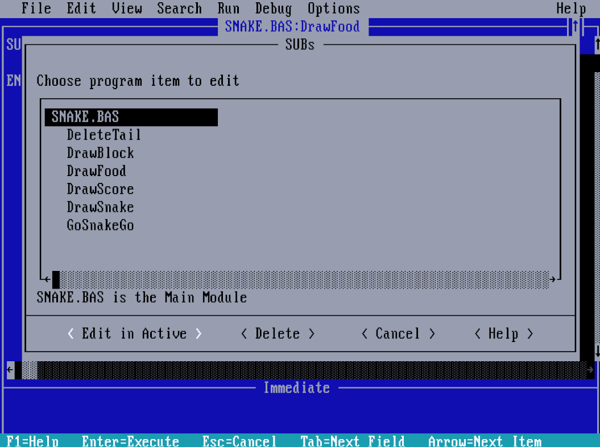

# MSSNAKE
  
Simple snake game for MS-DOS written in QBasic.
  

  
## Usage
  
Download all files and turn on your MS-DOS system (or DOSBox).  
Controls: `W` / `A` / `S` / `D` to move, `ESC` to quit.  
  
Run:  
  
`QBASIC.EXE /RUN SNAKE.BAS`
  
## Development
  
Built step by step in the default QBasic editor. The game is split into small SUBs, which you can browse with F2:

  
Check [`memories/`](memories/) for more.
  
## Known limitations
- No self-collision.
- Max snake length is 40.
## License
This project is licensed under the MIT License.
## Author
Created by **0l3d**

